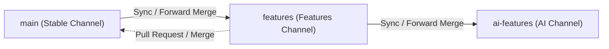

# Branch Workflow & Release Management

This document outlines the branch architecture, forward-merge procedures, build channels, and versioning rules for **Notepad by FerryPot**.

---

## 1. Branch Architecture

We maintain three primary development branches organized in a downstream cascade:



### Roles & Responsibilities

| Branch | Channel (`-p:BuildChannel`) | Purpose | Executable Name | Window Title Suffix | AppData Profile Directory |
|---|---|---|---|---|---|
| `main` | `Stable` | Production-ready, verified code. All releases and tags are created exclusively from this branch. | `NotepadByFerryPot.exe` | *(none)* | `%AppData%\NotepadByFerryPot` |
| `features` | `Features` | Feature testing and UX improvements in progress. Isolated configuration to avoid impacting stable settings. | `NotepadByFerryPot-features.exe` | `[Features]` | `%AppData%\NotepadByFerryPot-features` |
| `ai-features` | `AI` | Experimental AI assistance, LLM workflows, and next-generation features. Built upon `features`. | `NotepadByFerryPot-ai.exe` | `[AI]` | `%AppData%\NotepadByFerryPot-ai` |

---

## 2. Forward Merge Commands

To keep downstream branches synchronized with upstream fixes, bug fixes and stable improvements made on `main` are merged forward into `features`, and from `features` into `ai-features`.

### Syncing `main` into `features`

```bash
# 1. Switch to the features branch and update
git checkout features
git pull origin features

# 2. Merge changes from main
git merge main

# 3. Verify clean build and tests
dotnet build -c Release -p:BuildChannel=Features

# 4. Push updated features branch
git push origin features
```

### Syncing `features` into `ai-features`

```bash
# 1. Switch to the ai-features branch and update
git checkout ai-features
git pull origin ai-features

# 2. Merge changes from features
git merge features

# 3. Verify clean build and tests
dotnet build -c Release -p:BuildChannel=AI

# 4. Push updated ai-features branch
git push origin ai-features
```

### Promoting Completed Features to `main`

When features on the `features` branch are tested and ready for production:
1. Open a Pull Request from `features` into `main` on GitHub.
2. Ensure the GitHub Actions build passes cleanly.
3. Merge via Pull Request or local fast-forward/merge commit:
   ```bash
   git checkout main
   git pull origin main
   git merge --no-ff features
   git push origin main
   ```

---

## 3. Build Channels & Compilation

The project uses MSBuild properties to configure each channel at publish time.

### Publishing Executables Locally

- **Stable Channel:**
  ```bash
  dotnet publish NotepadByFerryPot.csproj -c Release -r win-x64 --self-contained false -p:PublishSingleFile=true -p:BuildChannel=Stable -o ./Publish
  ```
- **Features Channel:**
  ```bash
  dotnet publish NotepadByFerryPot.csproj -c Release -r win-x64 --self-contained false -p:PublishSingleFile=true -p:BuildChannel=Features -o ./Publish
  ```
- **AI Channel:**
  ```bash
  dotnet publish NotepadByFerryPot.csproj -c Release -r win-x64 --self-contained false -p:PublishSingleFile=true -p:BuildChannel=AI -o ./Publish
  ```

---

## 4. GitHub Actions Workflows

### Continuous Integration (`build.yml`)
- Triggers on push and pull requests targeting `main`, `features`, and `ai-features`.
- Identifies the target branch and compiles with the corresponding channel setting.
- Performs security audit for vulnerable package dependencies.
- Packages and publishes the channel single-file executable.
- Uploads the executable as a workflow artifact named after the branch (`main`, `features`, or `ai-features`).

### Releases (`release.yml`)
- Triggers on push of tags matching `v*` (e.g. `v1.0.0`, `v1.2.0-beta.1`).
- **Enforces tags on `main` only**: Verifies via git ancestry that the tagged commit belongs to `main`. Tags on other branches will not produce releases.
- Builds the production single-file executable `NotepadByFerryPot.exe`.
- Packages the binary as `NotepadByFerryPot-<tag>-win-x64.zip`.
- Publishes the GitHub Release with automated release notes.

---

## 5. Versioning Rules

We strictly adhere to [Semantic Versioning 2.0.0](https://semver.org/):

Format: `v<MAJOR>.<MINOR>.<PATCH>[-<PRERELEASE>]`

- **Stable Releases:**
  - Examples: `v1.0.0`, `v1.1.0`, `v1.1.1`
  - Created only on the `main` branch.
  - Generates a full GitHub release with downloadable single-file zip.
- **Pre-Releases:**
  - Examples: `v1.2.0-beta.1`, `v1.2.0-rc.1`, `v2.0.0-alpha.1`
  - Any tag containing a hyphen (`-`) is automatically marked as a **Pre-release** by GitHub Actions.
  - Used for public testing prior to final stable tagging.
